<h1 align="center">GNU Guix Automated Installation</h1>

  <b>In Code We Trust ⚙️ | Simplified Guix System Setup</b>

---

## 📖 Overview

This project provides an automated installation script for **GNU Guix**, designed to simplify and speed up the setup process on new systems.

The `install.sh` script:
- Automatically fixes and updates your `/mnt/etc/config.scm`
- Adds required `(nongnu packages …)` and `(kernel …)` entries
- Downloads and applies your `channels.scm`
- Initializes your Guix system via `guix time-machine`
- Reboots automatically when finished  

Perfect for custom or reproducible Guix installations!

---

## 🧰 Files

| File | Description |
|------|--------------|
| `install.sh` | Main installation script |
| `channels.scm` | Custom Guix channel list |
| `config.scm` | System configuration file |
| `screenshots/*.png` | Step-by-step installation screenshots |

---

## ⚙️ Usage

> 🧩 **Prerequisite:**  
> You must already be inside the Guix installation environment with your target filesystem mounted at `/mnt`.

### 1️⃣ Download the script and make it executabte
    wget https://short.securityops.co/install -O install.sh
    chmod +x install.sh
### 2️⃣  Run the installer
    ./install.sh

The script will:

    -Patch your /mnt/etc/config.scm

    -Fetch your based-channels.scm

    -Initialize Guix with your configuration

    -Automatically reboot when complete

🖼️ Installation Screenshots

Follow the visual guide below to see each step of the installation process.

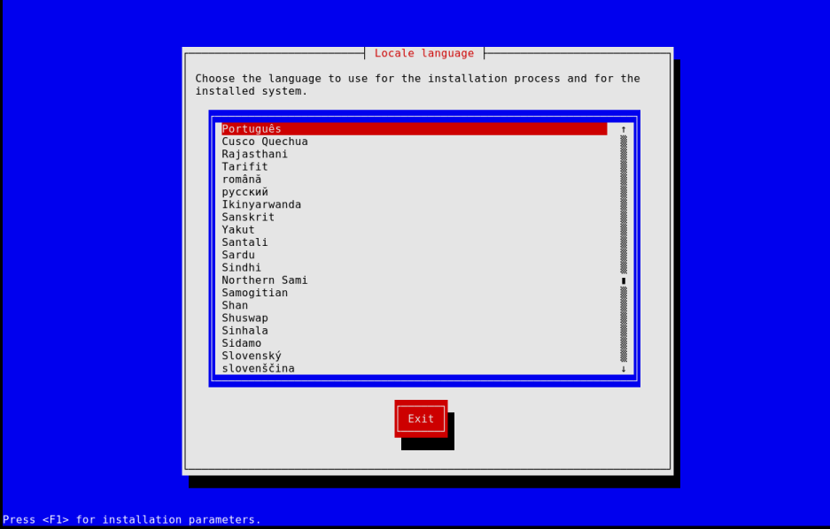
 
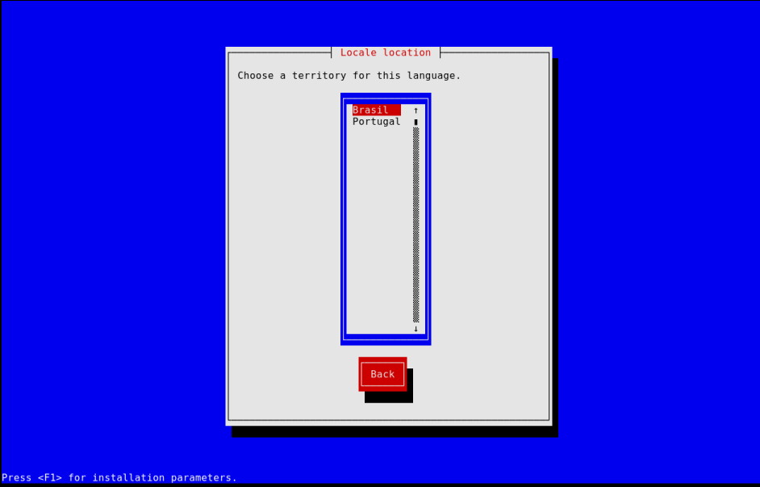
 
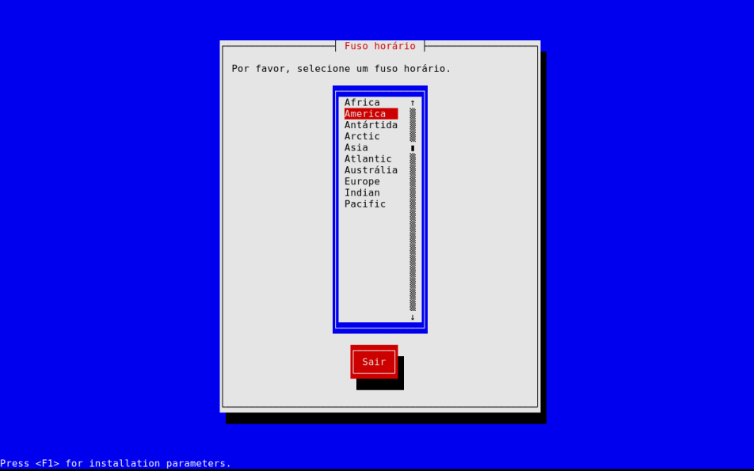
 
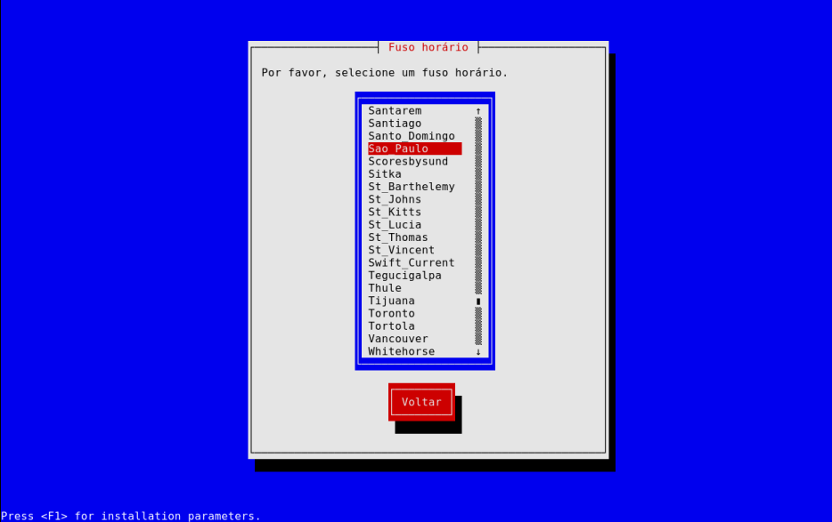
 
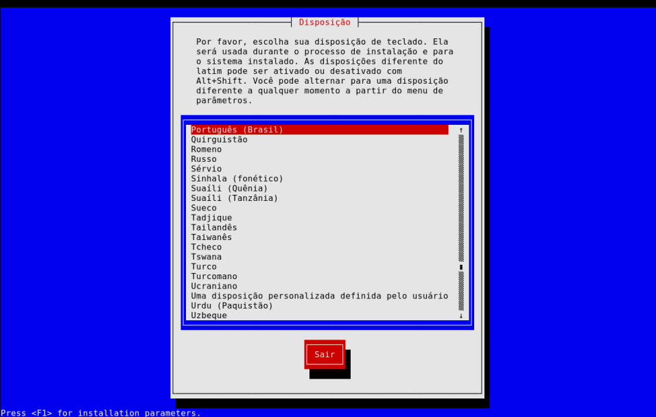
 
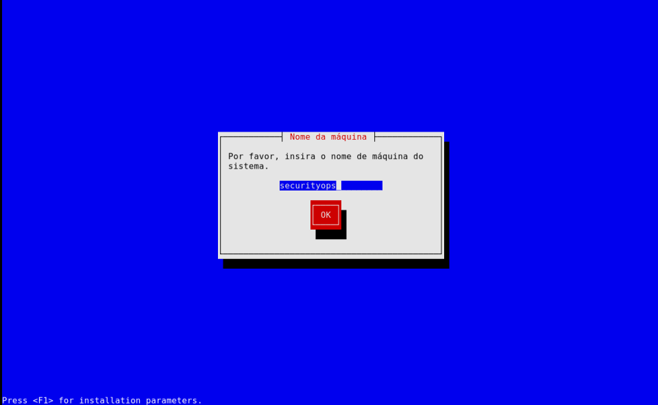
 
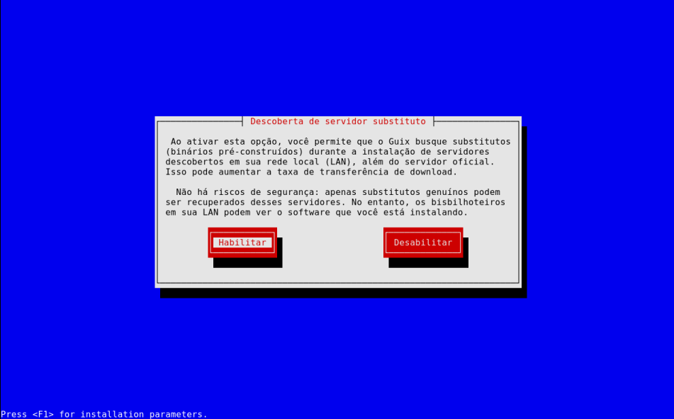
 
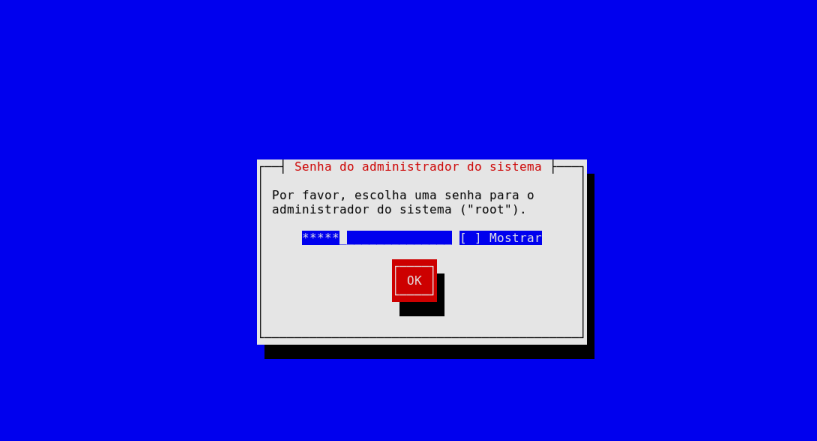
 
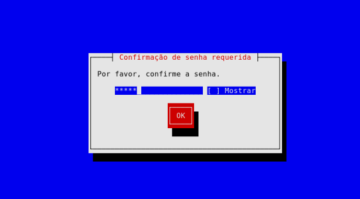
 
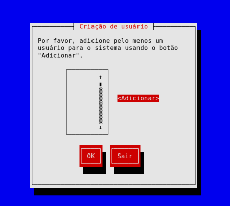
 
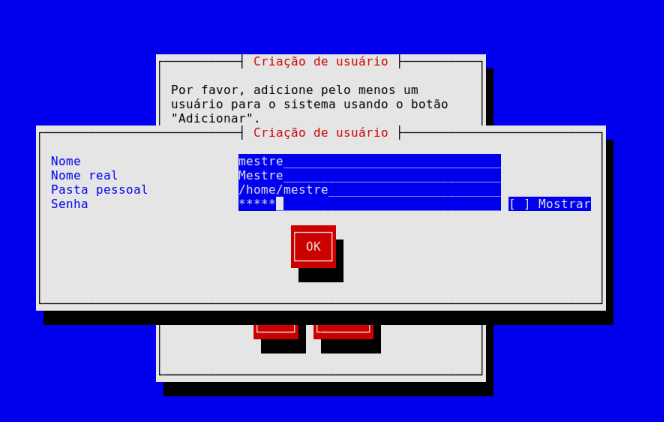
 
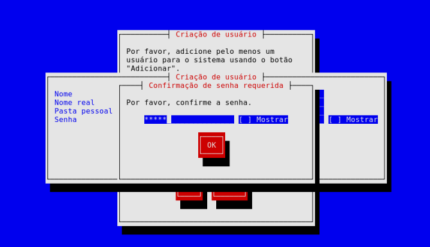
 
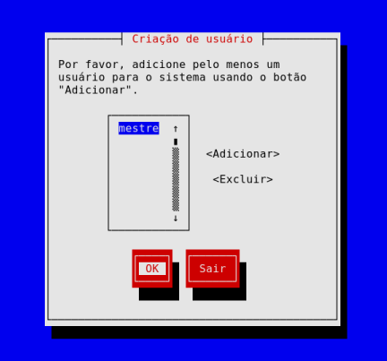
 
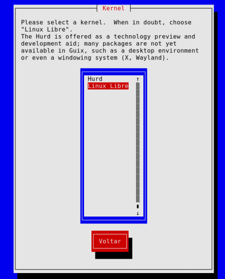
 
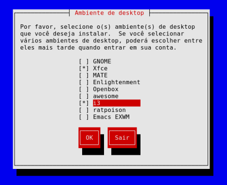
 
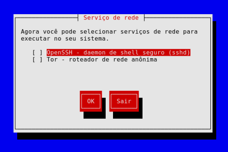
 
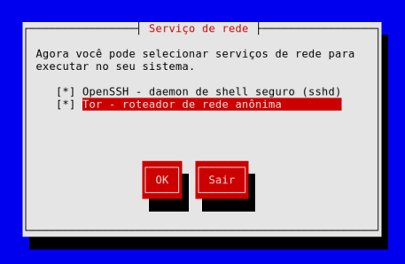
 
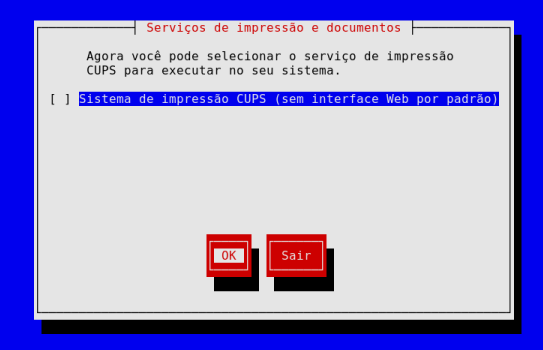
 
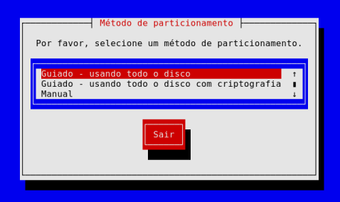
 
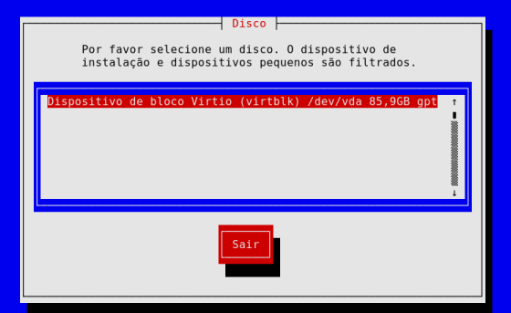
 
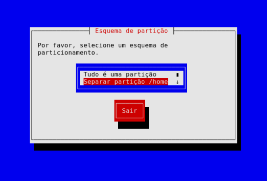
 
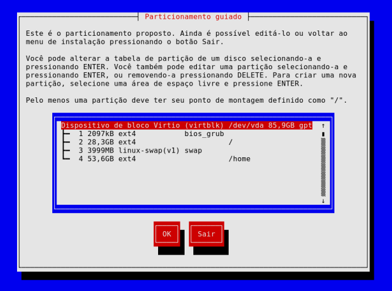
 
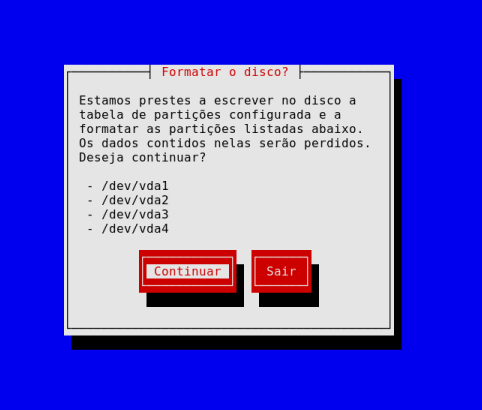
 
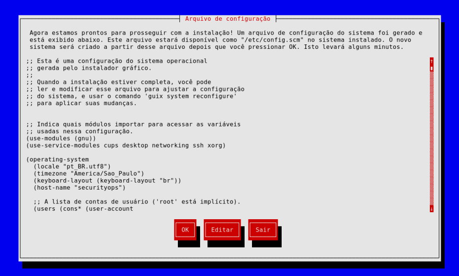
 
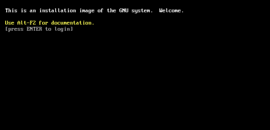
 
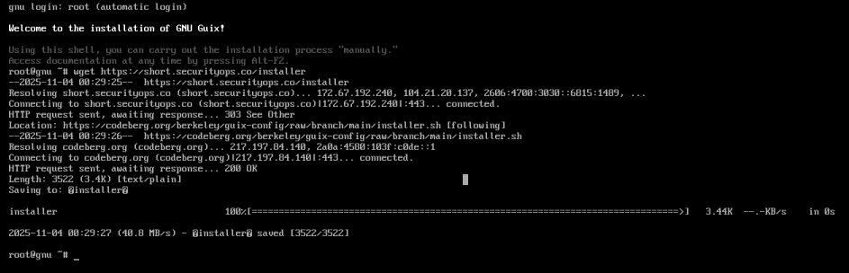
 
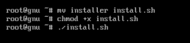
 
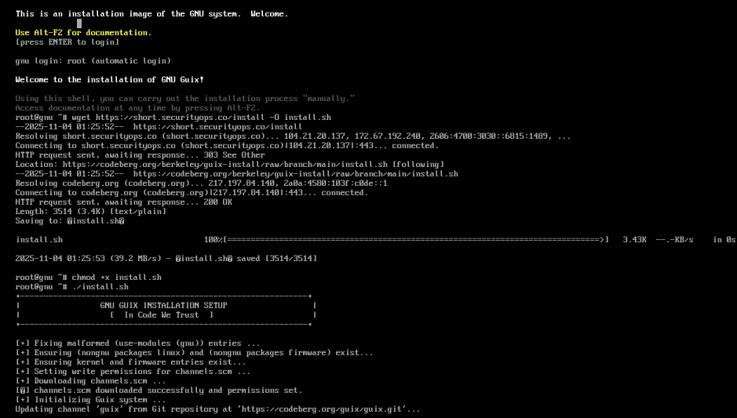

📜 License — BSD Zero Clause License (0BSD)

Copyright (C) 2025 Cristian Cezar Moisés

Permission to use, copy, modify, and/or distribute this software for any purpose with or without fee is hereby granted.

THE SOFTWARE IS PROVIDED "AS IS" AND THE AUTHOR DISCLAIMS ALL WARRANTIES WITH REGARD TO THIS SOFTWARE INCLUDING ALL IMPLIED WARRANTIES OF MERCHANTABILITY AND FITNESS. IN NO EVENT SHALL THE AUTHOR BE LIABLE FOR ANY SPECIAL, DIRECT, INDIRECT, OR CONSEQUENTIAL DAMAGES OR ANY DAMAGES WHATSOEVER RESULTING FROM LOSS OF USE, DATA OR PROFITS, WHETHER IN AN ACTION OF CONTRACT, NEGLIGENCE OR OTHER TORTIOUS ACTION, ARISING OUT OF OR IN CONNECTION WITH THE USE OR PERFORMANCE OF THIS SOFTWARE.
