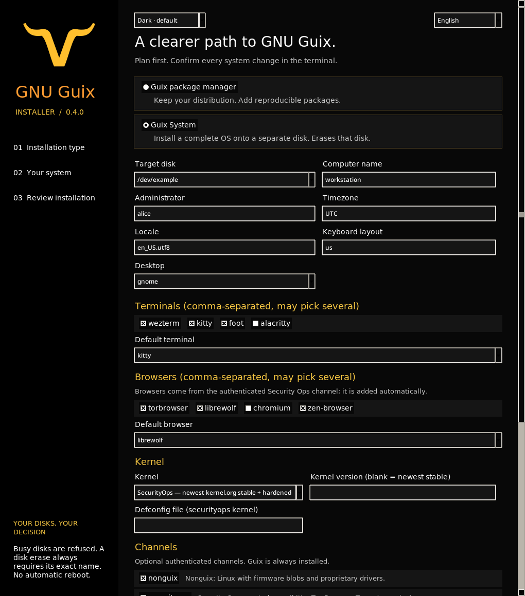

# GNU Guix Installer

**One launcher. A native GUI and a terminal wizard. Your choice of Guix alongside Linux or a complete Guix System.**

[Português (Brasil)](README.pt-BR.md) · [Security and limitations](SECURITY.md)



## What changed in 0.4.0

The system installer now offers three kernels, and the two non-free ones always
track the newest stable release from kernel.org (resolved at plan time and
pinned by SHA-256 in the generated configuration, currently 7.3.4):

| Kernel | Base | Source | Extra |
|---|---|---|---|
| **linux-libre** | GNU Guix default | pinned by the Guix channel | none |
| **linux** | Nonguix broad driver config | newest kernel.org stable | proprietary firmware |
| **securityops** | Nonguix + the maintainer's `/etc/securityops.defconfig` | newest kernel.org stable | hardened `kernel-arguments` |

The securityops kernel reproduces the maintainer's in-use recipe
(`inherit linux`, `#:defconfig` replaced by the bundled defconfig, nonguix
extra options kept). `--kernel-version 7.3` pins an exact release; blank means
newest stable. Optional channels from the maintainer's authenticated
`channels.guix` (Nonguix, Security Ops, Small Guix, Sops-Guix, Gocix,
Guix-Xlibre) are selectable in the GUI, the wizard and `--channel`, each with
a short description. Dependencies close automatically.

Desktops now cover KDE Plasma, Sway, XMonad on XLibre and River + XMonad on
Wayland, alongside GNOME, XFCE and minimal. Terminals are multi-select from
Wezterm, Kitty, Foot and Alacritty with one chosen as the default, which the
Sway and River skeletons bind to `$term`. Browsers are also multi-select
(Tor Browser, LibreWolf, Chromium, Zen Browser) with one default; they come
from the authenticated Security Ops channel, which is added automatically.

Windows users can download the build artifacts of this repository
(`GuixInstall.exe` and `GuixInstall.msi`, built by CI on windows-latest):
the program downloads the GNU Guix image and writes it to a USB disk under a
volume lock, so a Windows machine can be migrated to Guix System.

## What changed in 0.3.0

The GUI and terminal now include the official GNU Guix mark, attributed to Luis Felipe López Acevedo under CC BY-SA 4.0. The GUI uses a bundled transparent image and window icon; the CLI uses an ASCII adaptation of the same silhouette and a wordmark on narrow terminals. No runtime image package or logo download is needed. See [artwork provenance and license](assets/README.md).

This update fixes unknown read-only disk state, rechecks partition layout and mount identity before access/cleanup, bounds inventory queries, and replaces full dead-store enumeration with a daemon handshake. Read-only GUI queries run in the background and discard stale results after settings change. The bootstrap verifies up to four concurrent downloads and tries its next mirror on transport timeouts; any integrity failure still stops execution.


## Start with one command

Run as your ordinary user in a terminal on GNU/Linux:

```sh
bash -o pipefail -c 'curl --proto "=https" --tlsv1.2 -fsSL https://raw.githubusercontent.com/cristiancmoises/guix-install/main/bootstrap.sh | bash'
```

The launcher opens the GUI when Python Tk and a display are available, otherwise the terminal wizard. It downloads a commit-pinned source set with up to four concurrent requests and verifies every runtime file against embedded SHA-256 checksums. It keeps those sources in a private temporary directory so an installation terminal can continue after the GUI closes. Remove that printed directory only after all installation terminals have closed.

To explicitly select the terminal wizard:

```sh
bash -o pipefail -c 'curl --proto "=https" --tlsv1.2 -fsSL https://raw.githubusercontent.com/cristiancmoises/guix-install/main/bootstrap.sh | bash -s -- wizard'
```

A downloaded launcher is executable code: inspect `bootstrap.sh` first if you need to audit it. HTTPS protects the initial download; the embedded hashes protect its pinned payload, not a compromised launcher or hosting account. The launcher never installs distribution dependencies automatically.

## Choose what to install

| Mode | What changes | Requirements |
|---|---|---|
| **Guix package manager** — default | Adds Guix to the current distribution through the bundled official interactive installer. Creates its store, accounts, daemon and shell integration; asks about official substitutes. No partitioning. | GNU/Linux, Python 3.10+, Bash, wget, GnuPG, xz, standard account utilities; sudo/root for installation. Supported architectures and init systems follow the bundled upstream installer. |
| **Guix System** | **Erases one explicitly selected disk**, creates a GPT/FAT ESP/ext4 system, and runs authenticated `guix time-machine … system init`. | x86_64, UEFI, Secure Boot explicitly disabled, separate disk ≥32 GiB, network, an already working Guix daemon, partitioning/filesystem utilities. |

This release is an installation candidate, **not a claim of universal distribution compatibility or a boot-tested release**. Package-manager installation uses upstream compatibility checks. The system path has unit/fixture tests and real Guix configuration evaluation; destructive installation and boot still need qualification in a disposable VM.

For Guix System, first install the package manager if your live environment does not include it, then launch again and choose System. The tool refuses the running system's disk, mounted descendants, active swap, and device-mapper/RAID/LVM holders. Unknown root media or Secure Boot state is a refusal. Keep backups and use a separate disk. There is no `--yes` or `--force` bypass.

Initial system scope: unencrypted x86_64 UEFI with GNOME, XFCE, KDE Plasma,
Sway, XMonad (XLibre), River + XMonad (Wayland) or a minimal system;
Linux-libre by default. The `linux` and `securityops` kernels are explicit
opt-ins through authenticated pinned channels and always build the newest
kernel.org stable release. BIOS boot, ARM system installation, automatic
dual-boot resizing, RAID/LVM targets, encryption and disk recovery are
outside this release. A removable whole disk is allowed if it passes the same
checks; loop devices are refused. Minimal mode provides wired DHCP, not a
Wi-Fi setup wizard.

## GUI and CLI

From a checkout:

```sh
git clone https://codeberg.org/berkeley/guix-install.git
cd guix-install
./installer.sh                      # GUI when available; otherwise wizard
./installer.sh gui                  # native desktop wizard
./installer.sh wizard --lang pt-BR  # terminal wizard in Portuguese
./installer.sh doctor               # package-manager prerequisites
./installer.sh doctor --mode system
./installer.sh disks
./installer.sh plan --mode system --disk /dev/example --username alice
./installer.sh plan --mode system --disk /dev/example --kernel securityops \
    --channel securityops --channel small-guix
./installer.sh plan --kernel linux --kernel-version 7.3.4
./installer.sh plan --desktop sway --terminal kitty --terminal foot \
    --default-terminal foot --browser librewolf --default-browser librewolf
./installer.sh plan --json          # machine-readable; no installation commands
./installer.sh gui --theme light
```

`/dev/example` is a placeholder, never a suggested device. Use **Refresh disks** to inspect real disks and **Review installation** before continuing. For system settings, select System first. The GUI opens a terminal for sudo, private password entry, the exact `ERASE /dev/…` phrase and live progress. The GUI itself stays unprivileged. Supported terminal launchers: xterm, GNOME Terminal, Konsole, XFCE Terminal and MATE Terminal.

The default theme is **black, white text, golden yellow and orange**, inspired by Guix colors. Select **Light** for a white background and black text. The CLI accepts `--theme dark|light`, colors interactive plan output, and respects `NO_COLOR`; JSON and redirected output stay plain. English is the default; use the language selector or `--lang pt-BR`. The bundled upstream installer's own prompts and low-level system errors may remain English.

### Windows: migrate to Guix System from Windows

CI builds `GuixInstall.exe` (PyInstaller one-file) and `GuixInstall.msi`
(WiX) on windows-latest; download them from the workflow artifacts or a
release. Run as Administrator:

```bat
GuixInstall.exe list                      # inspect disks
GuixInstall.exe image --disk 2 --verify   # download GNU Guix, write disk 2, verify
GuixInstall.exe image --disk 2 --image D:\guix.iso
GuixInstall.exe doctor
```

The image writer refuses disks smaller than the image, holds a volume lock
for the whole write, and asks you to type the disk number before writing.
Reboot from the USB disk and the official Guix installer takes over. The
default image is the GNU Guix system installer from `ftp.gnu.org`; inspect it
and verify its signature separately if you need publisher authentication.

The GUI needs Python's actual Tk extension, usually `python3-tk` on Debian/Ubuntu or `python3-tkinter` on Fedora. Check with `python3 -c 'import tkinter'`. On Guix, include Python's `tk` output in your environment. CLI planning and the terminal wizard do not need Tk. Use Tab/Shift+Tab, Space and Enter; Ctrl+Enter reviews the plan. Content scrolls in smaller windows. Linux Tk screen-reader support depends on the desktop/toolkit; full accessibility certification is not claimed.


<details>
<summary>Light theme</summary>


</details>

These are captures of the real application. The CLI screenshot shows a plan for a fictional disk; none shows a completed installation.

## Safety and recovery

The system installer snapshots disk identity before consent, including kernel disk sequence, major/minor number, size and hardware identifiers, then rechecks before destructive commands. It uses a root-owned exclusive lock. These checks narrow races; they cannot defend against a malicious root process or concurrent privileged disk-management tools. Do not run other partitioning tools during installation.

Administrator passwords are entered privately in the terminal, passed to OpenSSL through standard input, and never placed in arguments or command logs. The salted SHA-512 verifier is written atomically only to the target's mode-0600 `/etc/shadow` after Guix init succeeds. The declarative configuration keeps accounts locked and does not put the verifier in the store; Guix account activation preserves the protected entry on first boot. Root remains locked. No SSH service or automatic reboot is added.

Command names and exit statuses are retained in a root-readable `/var/log/guix-install-*.log`; live subprocess output stays in the terminal. If a step fails, stop and inspect the log and disk. Only mounts created by that run are unmounted. A failed unmount preserves the recovery directory; cleanup never recursively removes a target filesystem. Partition changes cannot be undone by the tool. `install.sh` now forwards to the new launcher; it no longer rewrites an existing `/mnt/etc/config.scm`.

## Provenance and validation

The installer carries forward **specific safeguards**, not the full Security Ops OS distribution: fail-closed target checks, swap/holder protection, disk identity rechecks, private state, authenticated pinned channels, explicit firmware choice and no automatic reboot. It does not copy the ISO's package set, hardening claims, custom substitute keys or build gate status.

The upstream script is unchanged from [GNU Guix commit 94bbecec](https://codeberg.org/guix/guix/src/commit/94bbecec92475689df5b9056720795d40e0198a3/etc/guix-install.sh); its digest is in [vendor/provenance.json](vendor/provenance.json). The system-channel pins originate from the inspected `securityops-iso/channels.guix`: Guix `b9a35ee6` and Nonguix `bf39542c`, with their published introductions retained. Pins are deliberate compatibility inputs, not a promise that they are the latest or security-qualified releases. No custom substitute key is authorized by this wrapper.

```sh
python3 -m unittest discover -s tests -v
ruff check guix_installer tests scripts/prepare-bootstrap.py run.py
ruff format --check guix_installer tests scripts/prepare-bootstrap.py run.py
pyright guix_installer run.py scripts/prepare-bootstrap.py windows_main.py
shellcheck installer.sh install.sh bootstrap.sh
./scripts/check-guix.sh  # read-only expression checks; requires existing Guix
```


Upstream reference: [installing Guix on another distribution](https://guix.gnu.org/manual/en/html_node/Binary-Installation.html) and [installing Guix System](https://guix.gnu.org/manual/en/html_node/Proceeding-with-the-Installation.html).

## Mirrors and license

[Codeberg](https://codeberg.org/berkeley/guix-install) · [GitHub](https://github.com/cristiancmoises/guix-install) · [Security Ops BR](https://git.securityops.com.br/cristiancmoises/guix-install) · [Security Ops CO](https://git.securityops.co/cristiancmoises/guix-install)

GNU GPL; see [LICENSE](LICENSE). The vendored upstream file retains its own GPL-3.0-or-later copyright notice. This community project is not an official GNU Guix installer release.
