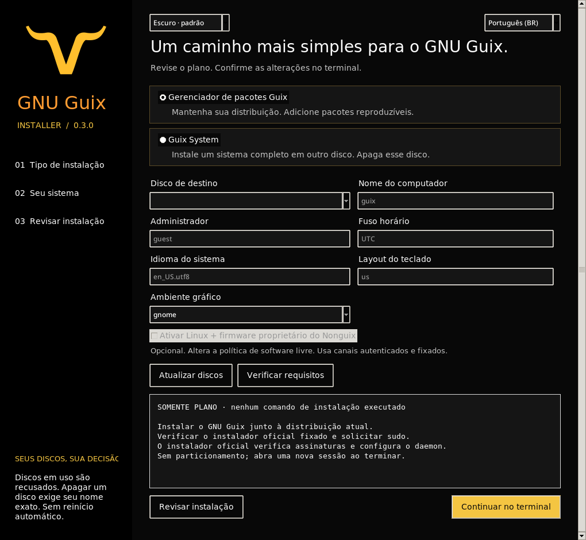
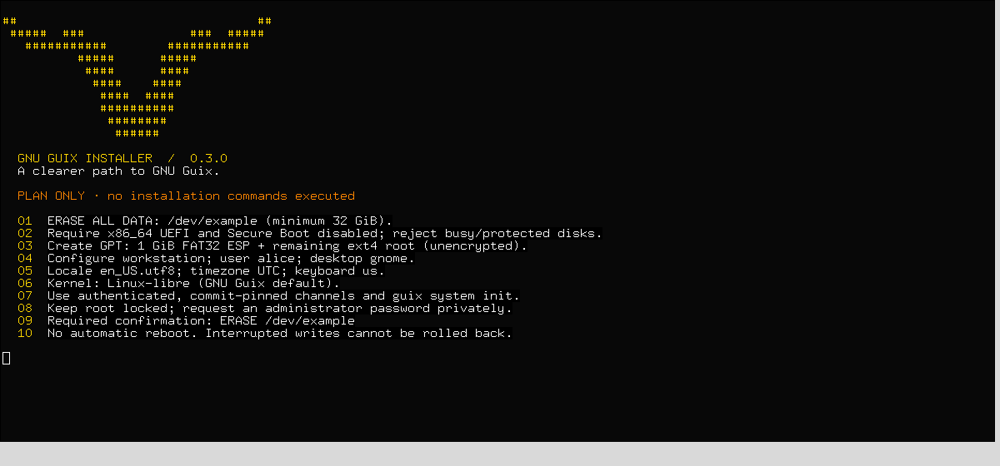
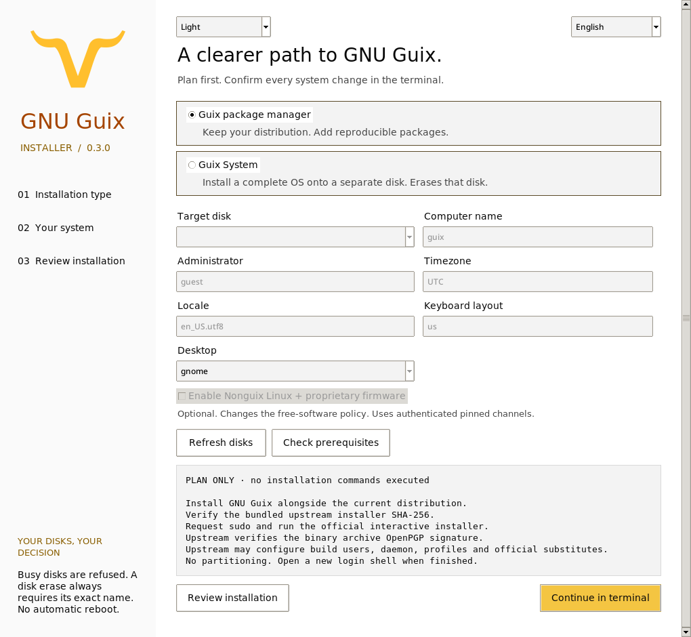

# Instalador GNU Guix

**Um lançador. Uma GUI nativa e um assistente no terminal. Escolha entre o Guix junto ao Linux atual ou o Guix System completo.**

[English — idioma padrão](README.md) · [Segurança e limitações](SECURITY.md)



## Novidades da versão 0.3.0

A GUI e o terminal agora incluem o símbolo oficial do GNU Guix, atribuído a Luis Felipe López Acevedo sob CC BY-SA 4.0. A GUI usa imagem transparente e ícone da janela; a CLI usa uma adaptação ASCII da mesma silhueta e o nome em terminais estreitos. Não é necessário instalar biblioteca de imagens nem baixar o logo durante a execução. Veja a [origem e licença da arte](assets/README.md).

Esta atualização corrige o estado desconhecido de disco somente leitura, confere novamente partições e identidade das montagens antes de acesso/limpeza, limita o tempo das consultas e substitui a enumeração completa de objetos mortos da store por uma conexão ao daemon. Consultas da GUI rodam em segundo plano e descartam resultados antigos quando os campos mudam. O lançador verifica até quatro downloads simultâneos e tenta o próximo espelho em timeouts de transporte; qualquer falha de integridade continua impedindo a execução.


## Comece com um comando

Execute como usuário comum em um terminal GNU/Linux:

```sh
bash -o pipefail -c 'curl --proto "=https" --tlsv1.2 -fsSL https://raw.githubusercontent.com/cristiancmoises/guix-install/main/bootstrap.sh | bash'
```

O lançador abre a GUI quando há uma sessão gráfica e o Python Tk está disponível; caso contrário, abre o assistente do terminal. Ele baixa fontes fixadas por commit com até quatro requisições simultâneas e verifica cada arquivo de execução com SHA-256 embutido. As fontes ficam em um diretório temporário privado, permitindo que o terminal de instalação continue depois que a GUI for fechada. Remova o diretório informado somente depois de fechar todos os terminais de instalação.

Para escolher explicitamente o terminal em português:

```sh
bash -o pipefail -c 'curl --proto "=https" --tlsv1.2 -fsSL https://raw.githubusercontent.com/cristiancmoises/guix-install/main/bootstrap.sh | bash -s -- wizard --lang pt-BR'
```

O lançador baixado é código executável: inspecione `bootstrap.sh` antes de executar se precisar auditá-lo. HTTPS protege o download inicial; os hashes protegem o conteúdo fixado, mas não um lançador ou uma conta de hospedagem comprometidos. Dependências da distribuição nunca são instaladas automaticamente.

## Escolha o que instalar

| Modo | Alterações | Requisitos |
|---|---|---|
| **Gerenciador de pacotes Guix** — padrão | Adiciona o Guix à distribuição atual pelo instalador oficial interativo incluído. Cria a store, contas, daemon e integração com o shell; pergunta sobre substitutos oficiais. Sem particionamento. | GNU/Linux, Python 3.10+, Bash, wget, GnuPG, xz, utilitários de contas; sudo/root para instalar. Arquiteturas e sistemas de inicialização seguem o instalador oficial incluído. |
| **Guix System** | **Apaga um disco explicitamente selecionado**, cria GPT/ESP FAT/raiz ext4 e executa `guix time-machine … system init` com canais autenticados. | x86_64, UEFI, Secure Boot explicitamente desativado, disco separado ≥32 GiB, rede, daemon Guix já funcional e utilitários de particionamento/sistemas de arquivos. |

Esta versão é uma candidata à instalação, **não uma declaração de compatibilidade com todas as distribuições ou uma versão validada por inicialização**. O modo de pacotes usa as verificações de compatibilidade oficiais. O modo System possui testes unitários/com fixtures e avaliação real das configurações Guix; instalação destrutiva e boot ainda precisam de validação em uma VM descartável.

Se o ambiente live não inclui Guix, instale primeiro o gerenciador de pacotes; depois execute novamente e escolha System. O programa recusa o disco do sistema em execução, partições montadas, swap ativa e dispositivos com dependentes RAID/LVM/device-mapper. Uma origem de boot ou um estado de Secure Boot desconhecido causa recusa. Faça backup e use um disco separado. Não existem opções `--yes` ou `--force` para ignorar essas verificações.

Escopo inicial do sistema: x86_64 UEFI sem criptografia, GNOME/XFCE/mínimo e Linux-libre como padrão. Linux com firmware proprietário pelo Nonguix exige escolha explícita e usa um canal autenticado e fixado. BIOS, instalação System em ARM, redimensionamento automático para dual boot, destinos RAID/LVM, criptografia e recuperação de discos estão fora desta versão. Um disco removível inteiro pode ser usado se passar pelas mesmas verificações; dispositivos loop são recusados. O modo mínimo fornece DHCP por cabo, sem assistente Wi-Fi.

## GUI e CLI

Em uma cópia do repositório:

```sh
git clone https://codeberg.org/berkeley/guix-install.git
cd guix-install
./installer.sh                      # GUI quando disponível; senão, terminal
./installer.sh gui --lang pt-BR      # assistente gráfico em português
./installer.sh wizard --lang pt-BR   # assistente do terminal
./installer.sh doctor               # requisitos do modo de pacotes
./installer.sh doctor --mode system
./installer.sh disks
./installer.sh plan --mode system --disk /dev/example --username alice
./installer.sh plan --json          # saída estruturada; sem instalar
./installer.sh gui --theme light
```

`/dev/example` é apenas um exemplo, nunca uma sugestão de disco. Use **Atualizar discos** para consultar os discos reais e **Revisar instalação** antes de continuar. Para editar os campos do sistema, selecione System primeiro. A GUI abre um terminal para sudo, entrada privada da senha, frase exata `ERASE /dev/…` e progresso. A GUI permanece sem privilégios. Terminais compatíveis: xterm, GNOME Terminal, Konsole, XFCE Terminal e MATE Terminal.

O tema padrão usa **fundo preto, texto branco, amarelo dourado e laranja**, inspirado nas cores do Guix. Escolha **Claro** para fundo branco e texto preto. A CLI aceita `--theme dark|light`, colore planos interativos e respeita `NO_COLOR`; JSON e saídas redirecionadas ficam sem códigos de cor. O idioma padrão é inglês; use o seletor ou `--lang pt-BR`. As perguntas do instalador oficial incluído e erros de baixo nível podem permanecer em inglês.

A GUI exige a extensão Tk real do Python, normalmente `python3-tk` no Debian/Ubuntu ou `python3-tkinter` no Fedora. Verifique com `python3 -c 'import tkinter'`. No Guix, inclua a saída `tk` do Python no ambiente. A CLI e os planos não precisam de Tk. Use Tab/Shift+Tab, Espaço e Enter; Ctrl+Enter revisa o plano. Há rolagem para janelas menores. O suporte a leitores de tela do Tk no Linux depende do ambiente; não há declaração de certificação completa de acessibilidade.



<details>
<summary>Tema claro</summary>



</details>

As imagens são capturas do programa real. A CLI mostra um plano para um disco fictício; nenhuma imagem representa uma instalação concluída.

## Segurança e recuperação

O instalador registra a identidade do disco antes da confirmação, incluindo sequência do kernel, número major/minor, tamanho e identificadores de hardware, e confere novamente antes dos comandos destrutivos. Um bloqueio exclusivo pertence ao root. Essas verificações reduzem corridas, mas não protegem contra um processo root malicioso ou outros programas privilegiados alterando discos ao mesmo tempo. Não execute outro particionador durante a instalação.

A senha do administrador é digitada de forma privada, enviada ao OpenSSL pela entrada padrão e nunca aparece em argumentos ou logs. O verificador SHA-512 com salt fica somente em `/etc/shadow` do destino, com modo 0600, escrito atomicamente após sucesso do Guix init. A configuração declarativa mantém as contas bloqueadas e não inclui o verificador na store; a ativação de contas do Guix preserva a entrada protegida no primeiro boot. O root permanece bloqueado. Nenhum serviço SSH ou reinício automático é adicionado.

Comandos e códigos de saída ficam em `/var/log/guix-install-*.log`, legível somente pelo root; a saída ao vivo dos subprocessos permanece no terminal. Em caso de falha, pare e inspecione o log e o disco. Somente montagens criadas pela execução são desmontadas. Falhas ao desmontar preservam o diretório de recuperação; a limpeza nunca remove recursivamente o sistema de arquivos de destino. O programa não desfaz alterações em partições. `install.sh` agora encaminha ao novo lançador e não reescreve `/mnt/etc/config.scm` existente.

## Origem e validação

Foram reaproveitadas **proteções específicas** do Security Ops OS: recusa de destinos inseguros, proteção de swap/dependentes, nova conferência de identidade, estado privado, canais autenticados e fixados, firmware opcional e ausência de reinício automático. Não são copiados o conjunto de pacotes da ISO, suas declarações de hardening, chaves de substitutos ou resultados de gates de compilação.

O instalador oficial está inalterado no [commit GNU Guix 94bbecec](https://codeberg.org/guix/guix/src/commit/94bbecec92475689df5b9056720795d40e0198a3/etc/guix-install.sh); o hash está em [vendor/provenance.json](vendor/provenance.json). Os commits dos canais vieram do `securityops-iso/channels.guix` consultado: Guix `b9a35ee6` e Nonguix `bf39542c`, preservando suas introduções publicadas. São escolhas de compatibilidade, sem promessa de serem versões mais recentes ou qualificadas para segurança. Este wrapper não autoriza chaves de substitutos personalizados.

```sh
python3 -m unittest discover -s tests -v
ruff check guix_installer tests scripts/prepare-bootstrap.py run.py
ruff format --check guix_installer tests scripts/prepare-bootstrap.py run.py
pyright guix_installer run.py scripts/prepare-bootstrap.py
shellcheck installer.sh install.sh bootstrap.sh
./scripts/check-guix.sh  # avaliação sem alterar o sistema; exige Guix existente
```


Referências oficiais: [Guix em outra distribuição](https://guix.gnu.org/manual/en/html_node/Binary-Installation.html) e [instalação do Guix System](https://guix.gnu.org/manual/en/html_node/Proceeding-with-the-Installation.html).

## Espelhos e licença

[Codeberg](https://codeberg.org/berkeley/guix-install) · [GitHub](https://github.com/cristiancmoises/guix-install) · [Security Ops BR](https://git.securityops.com.br/cristiancmoises/guix-install) · [Security Ops CO](https://git.securityops.co/cristiancmoises/guix-install)

GNU GPL; veja [LICENSE](LICENSE). O arquivo oficial incluído preserva seu aviso GPL-3.0-or-later. Este projeto comunitário não é uma versão oficial do instalador GNU Guix.
